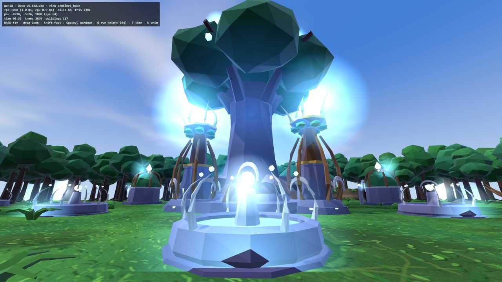
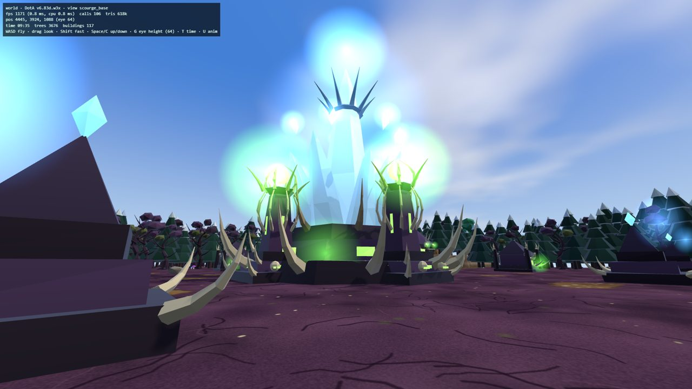
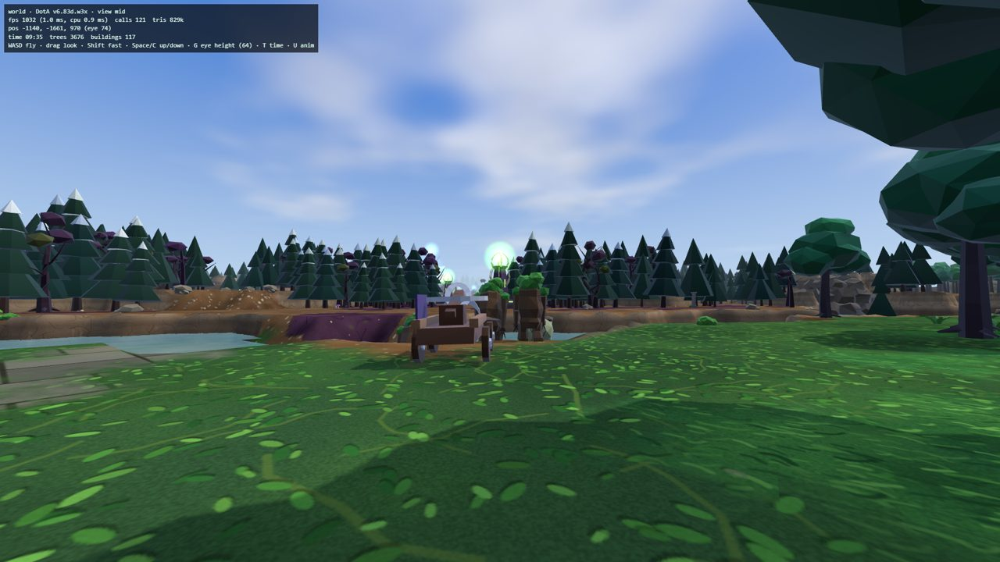
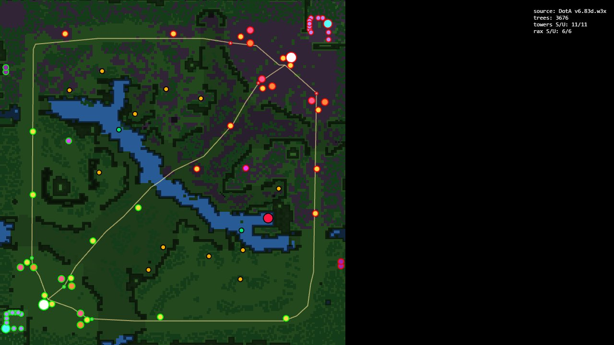

# DotA Allstars 6.83d — Sniper FPS

The Warcraft III **DotA Allstars v6.83d** map (Frozen Throne, the original, not Dota 2) rebuilt as a browser **first-person shooter**. You play Sniper (Kardel Sharpeye) with **Counter-Strike 1.6** controls.

The map layout comes from the real `.w3x` file: terrain, cliffs, river, every tree, tower, barracks and shop. Gameplay numbers come from the map's own data. All art and sound is original and procedurally generated; no Blizzard assets are used.

| Sentinel base | Scourge base |
|---|---|
|  |  |
| **Mid lane / river** | **Extracted map (top-down)** |
|  |  |

## Play / develop

```bash
npm install
npm run dev          # http://localhost:5173
```

| Key | Action |
|---|---|
| WASD / Space / Shift | move / jump / walk |
| Mouse, LMB | look, shoot (bolt-action, DotA attack speed) |
| RMB or E | scope (Take Aim): 2 zoom levels |
| Q / R / F | Shrapnel / Assassinate / Town Portal *(wave 2, on branch `wave2/kit`)* |
| Ctrl+Q/E/R/G | level up a skill *(wave 2)* |
| B / Tab | shop / scoreboard *(wave 2, on branch `wave2/ui`)* |

Tests: `npm run typecheck`, `npm test`, `npm run e2e` (run `npx playwright install chromium` first).

## Stack

Vite + TypeScript (strict) + three.js, with Vitest and Playwright. No React and no physics library. Map extraction uses our own MPQ reader in `tools/extract-map`.

## Docs

- [`docs/HANDOFF.md`](docs/HANDOFF.md): **start here.** Current status, branch map, next steps, the Gate 2 wiring checklist.
- [`docs/PLAN.md`](docs/PLAN.md): the full design and implementation plan.
- [`CLAUDE.md`](CLAUDE.md): code rules, contracts, folder ownership (also read by Claude Code).
- [`src/data/VERIFY.md`](src/data/VERIFY.md): balance values not yet confirmed.
